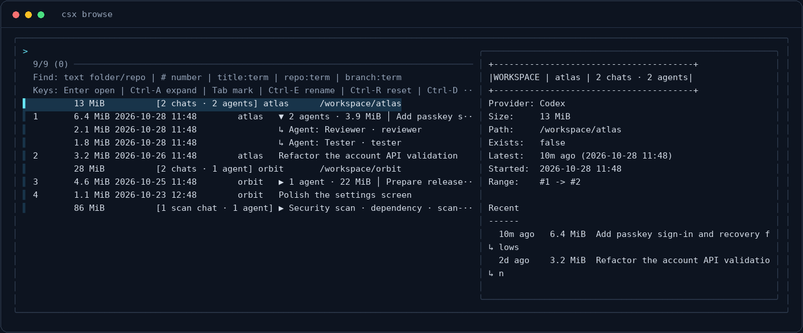
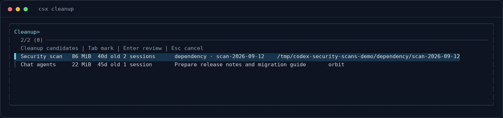

<h1 align="center">Agent Session Hub</h1>

<p align="center">
  Find, preview, and resume your AI coding sessions from the terminal.
</p>

<p align="center">
  <a href="https://github.com/vinzify/Agent-Session-Hub/actions/workflows/ci.yml"></a>
  <a href="https://github.com/vinzify/Agent-Session-Hub/releases/latest"></a>
  <a href="./LICENSE"></a>
</p>

<p align="center">
  <a href="#install">Install</a> ·
  <a href="#everyday-use">Usage</a> ·
  <a href="#storage-cleanup">Storage cleanup</a> ·
  <a href="#supported-providers">Providers</a> ·
  <a href="#google-antigravity-cli">Antigravity</a> ·
  <a href="./CONTRIBUTING.md">Contribute</a>
</p>

Agent Session Hub is a native Rust CLI for **Codex CLI, Claude Code, OpenCode,
and Google Antigravity CLI**.
It brings local session history into an `fzf` picker, groups conversations by
workspace, and reopens them from the right project directory.



*Actual terminal capture using fictional projects and sessions. Colors and layout
follow your terminal and `fzf` configuration.*

## Why use it?

- **Get back to work quickly.** Search across projects and branches, preview a
  conversation, and press `Enter` to resume.
- **Keep history readable.** Connected agents sit beneath their parent chat;
  generated Codex security scans collapse into one expandable row per run.
- **Understand storage use.** See individual session sizes, connected agent
  totals, and combined workspace totals.
- **Manage sessions in place.** Rename conversations, reset aliases, or delete
  supported sessions from the picker.
- **Keep large histories responsive.** An incremental metadata cache reuses
  unchanged Codex and Claude logs while refreshing aliases and Git information.
- **Use your existing tools.** No hosted account or additional runtime is
  required; release installs include a native executable.

## Install

**macOS / Linux**

```sh
curl -fsSL https://github.com/vinzify/Agent-Session-Hub/releases/latest/download/install.sh | sh
```

**Windows PowerShell**

```powershell
irm https://github.com/vinzify/Agent-Session-Hub/releases/latest/download/install.ps1 | iex
```

You need `fzf` **0.29 or newer** and at least one supported coding CLI in your `PATH`. The installer
adds `sessionhub`, `csx`, `clx`, `opx`, and `agx`, and sets up shell integration. Reload
your shell using the command printed by the installer.

Ubuntu 22.04's packaged `fzf` 0.29 is supported. Interactive compatibility is
checked in CI against fzf 0.29.0 and 0.67.0.

Upgrading from v0.4.x or v0.5.0? Run `sessionhub update`, then
`sessionhub providers` once: the new version adds missing shortcuts such as `agx`
automatically. No installer rerun is needed. Updates run by v0.5.1 and newer
perform that migration immediately. Installations older than v0.4.0 still need
the installer once to enable terminal updates. See [installation details](./docs/install.md).

### Updates from the terminal

Check the installed version with `sessionhub version`, `sessionhub --version`,
`sessionhub -V`, or `sessionhub -v`. The same forms work through provider shortcuts.
Lowercase `-v` is supported from v0.6.1. After upgrading, refresh older Bash/fish
provider functions with `sessionhub install-shell` and reopen your terminal.

```sh
sessionhub version
sessionhub check-update    # Check now, without installing anything
sessionhub update          # Confirm, verify, and install the latest stable release
```

`csx`, `clx`, `opx`, and `agx` accept these commands too. Interactive browsing checks for
updates in the background at most once per day and shows a terminal notice when
a newer stable release is known. It never installs updates automatically or
interrupts a running coding session. Short picker visits may show the result on
your next launch. Searching, previews, and non-interactive commands do not check.

The updater verifies the archive's SHA-256 against the release's `SHA256SUMS`,
replaces the installed binary/launcher copies, and leaves session data, aliases,
and shell profiles alone. Missing shortcuts are created automatically in your
recorded launcher directory; existing files and symlinks are never overwritten
by shortcut migration. Windows uses a helper after the updater process exits;
close other hub processes if Windows blocks replacement. Recovery is attempted
if a launcher replacement fails. Source/package-manager builds should use their
own installation method.

Set `AGENT_SESSION_HUB_NO_UPDATE_CHECK=1` to disable automatic checks; explicit
`check-update` still works. No GitHub account/token is required. Checks contact
GitHub with the app version, not your conversations or project paths.

## Everyday use

Open the provider chooser, or go straight to a specific history:

```sh
sessionhub     # Choose a provider
csx            # Codex CLI
clx            # Claude Code
opx            # OpenCode
agx            # Google Antigravity CLI (agy)
```

Workspaces and conversations appear in order of recent activity. The date column
shows the last update, so a resumed conversation moves back toward the top.
With shell integration, opening a session also changes your shell to its project
directory when that directory exists.

### Search

Type inside the picker, or pass a query when launching it:

```sh
csx browse atlas
csx browse repo:atlas
clx browse branch:main
opx browse title:release
csx browse 12
```

| Query | Matches |
| --- | --- |
| `atlas` | Project or repository names; also available agent names and paths |
| `repo:atlas` or `r:atlas` | Repository name |
| `branch:main` or `b:main` | Branch name |
| `title:release` or `t:release` | Conversation title or alias; also agent names and paths |
| `12` | Conversation numbers beginning with `12` |

### Picker shortcuts

| Key | Action |
| --- | --- |
| `Enter` | Resume the selected conversation; a workspace row opens its latest chat |
| `Ctrl-A` | Expand or collapse a connected agent tree or Codex security-scan run |
| `Tab` | Mark multiple rows for supported actions |
| `Ctrl-E` | Rename the selected session with a local alias |
| `Ctrl-R` | Reset its alias |
| `Ctrl-D` | Review and confirm deletion, where supported |
| `Esc` | Close the picker |

Searching for an agent keeps its parent conversation visible. Opening that agent
resumes the connected conversation. Claude agents without their root transcript
cannot be resumed separately. Deleting a root includes its connected agents.
For Claude, OpenCode, and Antigravity, deleting an expanded agent also includes
its connected descendants; Codex retains its single-agent-log deletion behavior.

### Direct commands

```sh
csx rename <session-id> --name "Account recovery"
csx reset <session-id>
csx delete <session-id>
csx doctor
```

Aliases are stored by Agent Session Hub. Preview any direct deletion first with
`delete <session-id> --dry-run`. Claude and Antigravity require confirmation (or
an explicit `--yes`); Codex and OpenCode retain their immediate direct-delete
behavior. `Ctrl-D` in the picker always asks for confirmation.
Run `csx help`, `clx help`, `opx help`, or `agx help` for commands, or
`sessionhub providers` to check provider availability.

## Storage cleanup

Agent histories can accumulate over time. The cleaner groups eligible logs by
parent chat or orphan workspace, with additional security-scan grouping for
Codex, and shows the size of the selected history.

Cross-provider agent trees, cleanup, and recoverable Claude/Antigravity deletion
are available in **v0.6.0 and newer**.



*Actual terminal capture with fictional cleanup candidates.*

Start with a preview that leaves session files unchanged:

```sh
csx cleanup --dry-run
```

Then select the groups you want to remove:

```sh
csx cleanup
```

Press `Tab` to mark groups, `Enter` to review them, and type the exact word
`DELETE` to confirm removal. `Esc` cancels the picker. Claude and Antigravity
retain a compressed recovery backup; Codex and OpenCode do not use this backup
mechanism.

| Category | Default age | What cleanup removes |
| --- | --- | --- |
| Security scans (Codex only) | 7 days | Generated scan chats and agents within a recognized scan run |
| Linked agents | 30 days | Eligible agent logs; the parent chat is retained |
| Orphan agents | 7 days | Eligible agent logs whose root chat is missing |
| Chats (opt-in `--chats`) | 90 days | An old root chat and all its connected agents |

Normal root chats are preserved unless you explicitly supply `--chats`.
Whole-chat and scan groups qualify only when every member passes the age
threshold. Cleanup does not select a Claude/OpenCode/Antigravity ancestor whose
deletion would include a newer or undeletable child. Recognized active
Antigravity entries are excluded. Cleanup removes local CLI history, not project
files or scan report directories. Groups that change during review are skipped
and can be reviewed again.

OpenCode ancestors with hidden archived descendants are not eligible for hub
deletion; manage those families through OpenCode so hidden history is not
silently included in a cascading delete. Alternate OpenCode stores selected via
the hub's session-root override are browse-only: the native CLI does not share
that setting, so the hub will not risk deleting from a different database.

Filter by category or choose a different retention period:

```sh
csx cleanup --security-scans
csx cleanup --dry-run --agents --older-than 90d
csx cleanup --orphans --older-than 7d
clx cleanup --dry-run --agents --older-than 60d
opx cleanup --dry-run --chats --older-than 180d
agx cleanup --dry-run --chats --older-than 90d
csx cleanup --help
```

You can combine category flags. Ages accept hours, days, or weeks (`12h`, `7d`,
`4w`); a bare number means days. Cleanup runs only when requested.

### Recoverable local-history deletion

Claude and Antigravity deletion is an **offline operation**: close the provider
and its background processes first (including Antigravity's IDE/language server
when running). The hub refuses detected writers, changed files, symlinks, busy
indexes, and unsupported Antigravity schemas rather than guessing how to edit
them. Prefer the provider's own history controls if the hub refuses a new format.

```sh
agx delete <session-id> --dry-run
agx delete <session-id> --yes

sessionhub antigravity recovery list
sessionhub antigravity recovery restore <backup-id>
sessionhub antigravity recovery purge <backup-id>
```

Use `sessionhub claude recovery ...` for Claude. Restore refuses to overwrite
newer history and requires the original configured session root. Purge asks for
`PURGE` confirmation; `--yes` bypasses that prompt. These generic commands work
with older shell functions; refresh optional shortcut functions with
`sessionhub install-shell` and reload your shell to use `agx recovery` / `clx recovery`.

Each deletion creates a private compressed backup under the hub's configuration
directory, containing the selected files, relevant metadata, and aliases. It
remains until **you explicitly purge it**, even after a restore. Review backups
regularly: compression reduces their size but does not guarantee immediate disk
space savings. Purging is irreversible. Run `agx doctor` or `clx doctor` to see
the recovery location. Backups contain private conversation data, not just titles.

The scope is the terminal app's saved history, like Codex—not your project,
account, or separate IDE/cloud copy. Claude removes the transcript and files in
its owned session subtree (including agent sidecars/tool-result files); Antigravity removes
selected conversation DB/WAL/SHM files and their local summary/search/cache
entries. Shared prompt history, unrelated caches, annotations, and artifacts are
not an all-traces-erased target. Imported IDE conversations are local copies;
the original must be managed in the IDE. Recovery is currently available only
for the new Claude and Antigravity deletion paths.

## Supported providers

| Capability | Codex CLI (`csx`) | Claude Code (`clx`) | OpenCode (`opx`) | Antigravity CLI (`agx`) |
| --- | --- | --- | --- | --- |
| Search, preview, and resume | Yes | Yes | Yes | Yes (index preview) |
| Workspace grouping and local aliases | Yes | Yes | Yes | Yes |
| Per-session storage sizes | File size | File size | Estimated payload size | DB + WAL/SHM files |
| Local session deletion | Yes | Yes (offline + recovery) | Yes (native CLI) | Yes (offline + recovery) |
| Connected agent trees | Yes | Yes | Yes | Yes |
| Security-scan grouping | Yes | — | — | — |
| Age-based storage cleanup | Yes | Yes | Yes | Yes |

OpenCode stores sessions in a shared SQLite database. Its displayed sizes are
estimates of session payloads, not guaranteed disk space reclaimed by deletion.
Agent grouping uses recorded parent relationships; it cannot reconstruct missing
lineage. Antigravity forks are independent chats, not automatically classified as
subagents. Per-session sizes exclude the hub's recovery backups; Claude sizes
measure transcript bytes, not the entire owned session subtree.

### Google Antigravity CLI

Available in v0.5.0 and newer.

Install Google's `agy` CLI separately and start a conversation there first. Then:

```sh
agx
agx browse title:release
sessionhub antigravity       # Same provider, without the shortcut
agx doctor
```

Browsing reads `~/.gemini/antigravity-cli/conversation_summaries.db` in read-only
mode and resumes a selection with [`agy --conversation <id>`](https://antigravity.google/docs/cli/commands/resume/).
Titles, short previews, workspace paths, and last activity come from that index;
the hub does not decode the private protobuf step data. Only indexed conversations
with a local `conversations/<id>.db` file and a file-URI workspace are shown.
Older IDE-only history and remote-only entries are not listed as CLI sessions.
Use Antigravity's own `/resume` import flow to bring IDE conversations into its
CLI store first. Multi-workspace conversations use their first local workspace.

Sizes include the individual database and any `-wal` / `-shm` companion files,
not the shared summary index, artifacts, or caches. Browsing never checkpoints
or deletes Antigravity databases. Aliases are hub-local. Explicit offline
deletion updates only the selected known local records after saving a recovery
backup; it does not invoke undocumented provider RPCs. See
[recoverable deletion](#recoverable-local-history-deletion) for safeguards and limits.

**Upgrading an existing installation:** v0.5.1 automatically adds missing
shortcuts, including `agx`, without changing your shell profile. When upgrading
through the older v0.4.x/v0.5.0 updater, run an existing command such as
`sessionhub providers` after the update to trigger the one-time migration.
Subsequent updates run migration immediately. The new shortcut works without
reloading the shell. To also refresh optional shell functions that change your
parent shell's directory, run `sessionhub install-shell` and reload your shell.

For a non-default CLI store, set `CODEX_SESSION_HUB_ANTIGRAVITY_SESSION_ROOT` to
the directory containing `conversation_summaries.db` and `conversations/`.

## Performance and local data

Alias files are not disposable caches. Invalid JSON, unsupported schema versions,
or unknown alias fields now produce an error and are left untouched. Repair the
file or restore a known-good backup; do not delete it if you need its aliases.
Alias saves use flushed, same-directory atomic replacements to prevent truncated
writes. Conversation logs are separate from this index.

Codex and Claude session metadata is cached in your operating system's cache
directory under `agent-session-hub`. Only new or changed logs are reparsed;
removed logs disappear on the next load. Aliases, relative ages, project
existence, and Git information are refreshed each time.

The cache contains identifiers, paths, timestamps, and short previews. It can be
removed and will rebuild automatically. Set `CODEX_SESSION_HUB_DISABLE_CACHE=1`
to bypass it, or `CODEX_SESSION_HUB_CACHE_ROOT` to choose another cache directory.
See [architecture and configuration](./docs/architecture.md) for details.

## Build and contribute

Rust is required only when building from source:

```sh
git clone https://github.com/vinzify/Agent-Session-Hub.git
cd Agent-Session-Hub
cargo test --locked
./install.sh
```

On Windows, use `.\install.ps1` for the local install.

Read [CONTRIBUTING.md](./CONTRIBUTING.md) for development and release guidance.
Bug reports are welcome in [GitHub Issues](https://github.com/vinzify/Agent-Session-Hub/issues);
include your OS, provider, and the output of the relevant `doctor` command.

Licensed under the [MIT License](./LICENSE).
