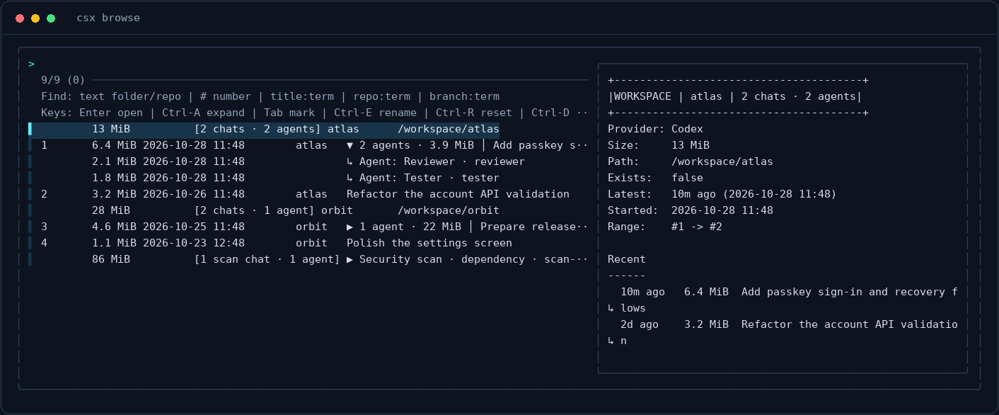
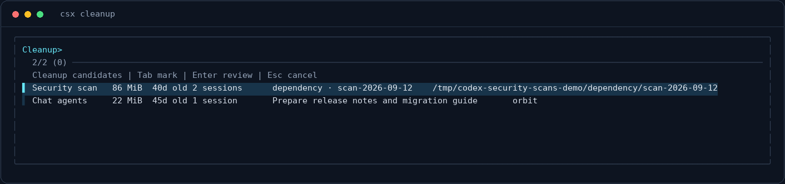

<h1 align="center">Agent Session Hub</h1>

<p align="center">
  Find, preview, and resume your AI coding sessions from the terminal.
</p>

<p align="center">
  <a href="https://github.com/vinzify/Agent-Session-Hub/actions/workflows/ci.yml"></a>
  <a href="https://github.com/vinzify/Agent-Session-Hub/releases/latest"></a>
  <a href="./LICENSE"></a>
</p>

<p align="center">
  <a href="#install">Install</a> ·
  <a href="#everyday-use">Usage</a> ·
  <a href="#storage-cleanup">Storage cleanup</a> ·
  <a href="#supported-providers">Providers</a> ·
  <a href="./CONTRIBUTING.md">Contribute</a>
</p>

Agent Session Hub is a native Rust CLI for **Codex CLI, Claude Code, and OpenCode**.
It brings local session history into an `fzf` picker, groups conversations by
workspace, and reopens them from the right project directory.



*Actual terminal capture using fictional projects and sessions. Colors and layout
follow your terminal and `fzf` configuration.*

## Why use it?

- **Get back to work quickly.** Search across projects and branches, preview a
  conversation, and press `Enter` to resume.
- **Keep history readable.** Codex agents sit beneath their parent chat;
  generated security scans collapse into one expandable row per run.
- **Understand storage use.** See individual session sizes, connected agent
  totals, and combined workspace totals.
- **Manage sessions in place.** Rename conversations, reset aliases, or delete
  supported sessions from the picker.
- **Keep large histories responsive.** An incremental metadata cache reuses
  unchanged Codex and Claude logs while refreshing aliases and Git information.
- **Use your existing tools.** No hosted account or additional runtime is
  required; release installs include a native executable.

## Install

**macOS / Linux**

```sh
curl -fsSL https://github.com/vinzify/Agent-Session-Hub/releases/latest/download/install.sh | sh
```

**Windows PowerShell**

```powershell
irm https://github.com/vinzify/Agent-Session-Hub/releases/latest/download/install.ps1 | iex
```

You need `fzf` **0.29 or newer** and at least one supported coding CLI in your `PATH`. The installer
adds `sessionhub`, `csx`, `clx`, and `opx`, and sets up shell integration. Reload
your shell using the command printed by the installer.

Ubuntu 22.04's packaged `fzf` 0.29 is supported. Interactive compatibility is
checked in CI against fzf 0.29.0 and 0.67.0.

Run the same installer to update. See [installation details](./docs/install.md)
for source builds, supported platforms, and uninstall instructions.

## Everyday use

Open the provider chooser, or go straight to a specific history:

```sh
sessionhub     # Choose a provider
csx            # Codex CLI
clx            # Claude Code
opx            # OpenCode
```

Workspaces and conversations appear in order of recent activity. The date column
shows the last update, so a resumed conversation moves back toward the top.
With shell integration, opening a session also changes your shell to its project
directory when that directory exists.

### Search

Type inside the picker, or pass a query when launching it:

```sh
csx browse atlas
csx browse repo:atlas
clx browse branch:main
opx browse title:release
csx browse 12
```

| Query | Matches |
| --- | --- |
| `atlas` | Project or repository names; also Codex agent names and paths |
| `repo:atlas` or `r:atlas` | Repository name |
| `branch:main` or `b:main` | Branch name |
| `title:release` or `t:release` | Conversation title or alias; also agent names and paths |
| `12` | Conversation numbers beginning with `12` |

### Picker shortcuts

| Key | Action |
| --- | --- |
| `Enter` | Resume the selected conversation; a workspace row opens its latest chat |
| `Ctrl-A` | Expand or collapse a Codex agent tree or security-scan run |
| `Tab` | Mark multiple rows for supported actions |
| `Ctrl-E` | Rename the selected session with a local alias |
| `Ctrl-R` | Reset its alias |
| `Ctrl-D` | Review and confirm deletion, where supported |
| `Esc` | Close the picker |

Searching for an agent keeps its parent conversation visible. Opening that agent
resumes the connected conversation. Deleting a root conversation includes its
connected agent logs; deleting an expanded agent removes only that agent log.

### Direct commands

```sh
csx rename <session-id> --name "Account recovery"
csx reset <session-id>
csx delete <session-id>
csx doctor
```

Aliases are stored by Agent Session Hub. `delete` removes session data and is
immediate when invoked as a direct command; use `Ctrl-D` in the picker for an
interactive confirmation. Run `csx help`, `clx help`, or `opx help` for commands,
or `sessionhub providers` to check provider availability.

## Storage cleanup

Codex scan and agent logs can accumulate over time. The cleaner groups eligible
logs by scan run, parent chat, or orphan workspace and shows how much space each
group occupies.



*Actual terminal capture with fictional cleanup candidates.*

Start with a preview that leaves session files unchanged:

```sh
csx cleanup --dry-run
```

Then select the groups you want to remove:

```sh
csx cleanup
```

Press `Tab` to mark groups, `Enter` to review them, and type the exact word
`DELETE` to confirm permanent removal. `Esc` cancels the picker.

| Category | Default age | What cleanup removes |
| --- | --- | --- |
| Security scans | 7 days | Generated scan chats and agents within a recognized scan run |
| Linked agents | 30 days | Eligible agent logs; the parent chat is retained |
| Orphan agents | 7 days | Eligible agent logs whose root chat is missing |

Normal root chats are never cleanup candidates. A security-scan run becomes
eligible only after its newest session passes the age threshold. Cleanup removes
the selected session logs, not project files or scan report directories.
Groups that change while you review them are skipped and can be reviewed again.

Filter by category or choose a different retention period:

```sh
csx cleanup --security-scans
csx cleanup --dry-run --agents --older-than 90d
csx cleanup --orphans --older-than 7d
csx cleanup --help
```

You can combine category flags. Ages accept hours, days, or weeks (`12h`, `7d`,
`4w`); a bare number means days. Cleanup runs only when requested.

## Supported providers

| Capability | Codex CLI (`csx`) | Claude Code (`clx`) | OpenCode (`opx`) |
| --- | --- | --- | --- |
| Search, preview, and resume | Yes | Yes | Yes |
| Workspace grouping and local aliases | Yes | Yes | Yes |
| Per-session storage sizes | File size | File size | Estimated payload size |
| Session deletion | Yes | No | Yes |
| Connected agent trees and scan grouping | Yes | — | — |
| Age-based storage cleanup | Yes | — | — |

OpenCode stores sessions in a shared SQLite database. Its displayed sizes are
estimates of session payloads, not guaranteed disk space reclaimed by deletion.

## Performance and local data

Codex and Claude session metadata is cached in your operating system's cache
directory under `agent-session-hub`. Only new or changed logs are reparsed;
removed logs disappear on the next load. Aliases, relative ages, project
existence, and Git information are refreshed each time.

The cache contains identifiers, paths, timestamps, and short previews. It can be
removed and will rebuild automatically. Set `CODEX_SESSION_HUB_DISABLE_CACHE=1`
to bypass it, or `CODEX_SESSION_HUB_CACHE_ROOT` to choose another cache directory.
See [architecture and configuration](./docs/architecture.md) for details.

## Build and contribute

Rust is required only when building from source:

```sh
git clone https://github.com/vinzify/Agent-Session-Hub.git
cd Agent-Session-Hub
cargo test --locked
./install.sh
```

On Windows, use `.\install.ps1` for the local install.

Read [CONTRIBUTING.md](./CONTRIBUTING.md) for development and release guidance.
Bug reports are welcome in [GitHub Issues](https://github.com/vinzify/Agent-Session-Hub/issues);
include your OS, provider, and the output of the relevant `doctor` command.

Licensed under the [MIT License](./LICENSE).
